# 📦 Projet Métabox - Hub d'Accompagnement Pédagogique (HECh)

> Référentiel complet extrait de la plateforme Moodle officielle de la Haute École Charlemagne (**Cours ID : 685**).
> Destiné à l'intégration, l'analyse et l'assistance pédagogique outillée par IA.

---

## 🏛️ Vue d'Ensemble et Missions

La **Métabox** est le dispositif central du **Service d'Accompagnement à la Réussite (SAR)** de la Haute École Charlemagne. Elle vise à doter les étudiants du supérieur de méthodologies d'apprentissage robustes, de compétences communicationnelles précises (compréhension et rédaction de consignes d'examens), de rigueur orthographique et de compétences numériques de base.

---

## 🗂️ Architecture Globale des 7 Tuiles Métabox

```mermaid
graph TD
    M[MÉTABOX HECh - SAR] --> T1[Tuile 1 : Métabox News]
    M --> T2[Tuile 2 : Partie Langagière]
    M --> T3[Tuile 3 : Glossaire Général]
    M --> T4[Tuile 4 : Partie Méthodologie]
    M --> T5[Tuile 5 : Partie Étudiant.e]
    M --> T6[Tuile 6 : Compétences Numériques]
    M --> T7[Tuile 7 : Ortho'Express]

    T2 --> M1[Module 1 : Intro & Diagnostic]
    T2 --> M2[Module 2 : Vocabulaire des Consignes]
    T2 --> M3[Module 3 : Analyse des Consignes]
    T2 --> M4[Module 4 : Rédaction de la Réponse]
    T2 --> M5[Module 5 : Exercices Récapitulatifs]

    T4 --> PM1[Module 1 : Mémorisation Efficace]
    T4 --> PM2[Module 2 : Gestion des Échéances & Loi de Parkinson]
    T4 --> PM3[Module 3 : Priorisation & Planification Hebdomadaire]

    T5 --> PE1[Lexique du métier d'étudiant]
    T5 --> PE2[Entraînements ludifiés & Quiz]

    T7 --> OE1[Check-list Ortho'Express & Guide]
    T7 --> OE2[Conjugaison & Déterminants]
    T7 --> OE3[Ponctuation & Accords]
```

---

## 📑 Détail des Modules & Contenus Pédagogiques

### 📰 Tuile 1 : Métabox News
* **Objectif** : Diffusion trimestrielle des actualités, conseils méthodologiques saisonniers (rentrée, blocus, sessions d'examens de janvier et juin).
* **Ressources archivées** :
  - *Édition 2024-2025* : Octobre 2024, Décembre 2024, Février 2025, Avril 2025 (PDFs).
  - *Édition 2025-2026* : Octobre 2025, Décembre 2025, Avril 2026, Mai 2026 (PDFs).

---

### ✍️ Tuile 2 : La Partie Langagière
*L'un des piliers essentiels pour réussir les évaluations et examens académiques.*

1. **Module 1 : Introduction et auto-évaluation en français**
   - Test diagnostique initial de positionnement (partenariat TELUQ).
   - Exercices 1, 2, 3 et 4 avec feedbacks formatifs immédiats.
2. **Module 2 : Vocabulaire des consignes d’évaluation**
   - Décryptage des verbes d'action cognitifs (analyser, synthétiser, comparer, justifier, illustrer).
   - Exercice 1 : Les locutions.
   - Exercice 2 : Les conjonctions de coordination et de subordination.
   - Les mots interrogatifs et pronoms interrogatifs.
3. **Module 3 : Analyse de consignes**
   - Méthode de découpage d'une question d'examen en sous-tâches.
   - Exercice 1 & 2 d'application sur vraies consignes d'enseignants.
4. **Module 4 : Comment rédiger la bonne réponse**
   - Alignement de la réponse sur le gabarit attendu par le correcteur.
5. **Module 5 : Exercices récapitulatifs**
   - Les mots essentiels d'une consigne.
   - Les verbes de consigne.
   - Vocabulaire contextuel des examens.

---

### 📖 Tuile 3 : Glossaire Général
* **Glossaire terminologique transversal** : Définitions claires des concepts institutionnels, académiques et pédagogiques du supérieur (ECTS, crédits, prérequis, co-requis, UE, AA, recours, dispenses).

---

### 🧠 Tuile 4 : La Partie Méthodologie
*Construire une stratégie de travail universitaire pérenne et éviter l'échec par procrastination.*

* **Module 1 : Comment mémoriser efficacement ?**
  - Neuro-pédagogie de l'apprentissage (réactivation espacée, double codage, fiches de révision actives).
  - Exercices interactifs de validation.
* **Module 2 : Comment gérer les échéances ?**
  - Compréhension et application de la **Loi de Parkinson** ("le travail s'étale de façon à occuper le temps disponible").
  - Outils anti-procrastination.
* **Module 3 : Prioriser et planifier sa semaine de travail**
  - Grille de priorisation (matrice d'Eisenhower adaptée aux études).
  - Modèle téléchargeable : *« Identifier et planifier les tâches »* (`.docx`).

---

### 🎓 Tuile 5 : La Partie Étudiant.e
*Comprendre ce qu'implique d'entrer dans l'enseignement supérieur et dans un collectif d'adultes apprenants.*

* **Le métier d'étudiant – Lexique** : Droits, devoirs, organisation de la vie étudiante.
* **Entraînements interactifs et ludifiés** :
  - *Entraînement 1 & 2* : Mini-jeux pédagogiques (Moodle Game module).
  - *Entraînement 3* : Quiz d'auto-positionnement réflexif.

---

### 💻 Tuile 6 : Compétences Numériques de Base
*Garantir l'autonomie sur les outils numériques obligatoires de l'école.*

* **Quiz Test diagnostique numérique**.
* **Guides et tutoriels intégrés (sous-sections dépliables)** :
  1. Prise en main de l'environnement Microsoft 365 institutionnel (Outlook, OneDrive, Teams).
  2. Organisation des dossiers et gestion des fichiers dans le Cloud.
  3. Utilisation avancée de la plateforme Moodle HECh.
  4. Rédaction et mise en page normalisée de travaux académiques (Word).
  5. Conception de supports de présentation oraux (PowerPoint).
  6. Règles élémentaires de cybersécurité et protection des données personnelles.

---

### 📏 Tuile 7 : Ortho'Express
*Dispositif de remédiation orthographique rapide et d'auto-correction avant remise de travaux écrits.*

* **Outils d'auto-contrôle** :
  - *Check-list Ortho'Express* (méthode de relecture sélective en 5 passes).
  - *Guide d'utilisation de la Check-list*.
* **Ateliers ciblés de remédiation** :
  - *Ponctuation et syntaxe* : Règles sur le point d'exclamation, virgule et articulation logique.
  - *Conjugaison* : Exercice 1 & 2 (accords des participes passés avec être/avoir, verbes pronominaux).
  - *Accords dans le groupe nominal* : Déterminants, adjectifs qualificatifs et pluriels complexes.
  - *Modules d'exercices en ligne autocorrectifs*.

---

## 📂 Contenu des Fichiers Aspirés dans ce Dépôt

* `METABOX_FULL_DOCUMENTATION.md` : Transcription intégrale brute des textes de chaque page Moodle.
* `moodle_all_sections_detailed.json` : Cartographie JSON complète des 7 sections, de leurs URLs et activités.
* `metabox_complete_export.json` : Export JSON structuré avec contenu textuel des 27 pages aspirées.
* `index_course_685.html` : Code source HTML complet de la page principale du cours.
* `moodle_pages/` : Dossier contenant l'intégralité des 27 pages HTML sauvegardées localement.
